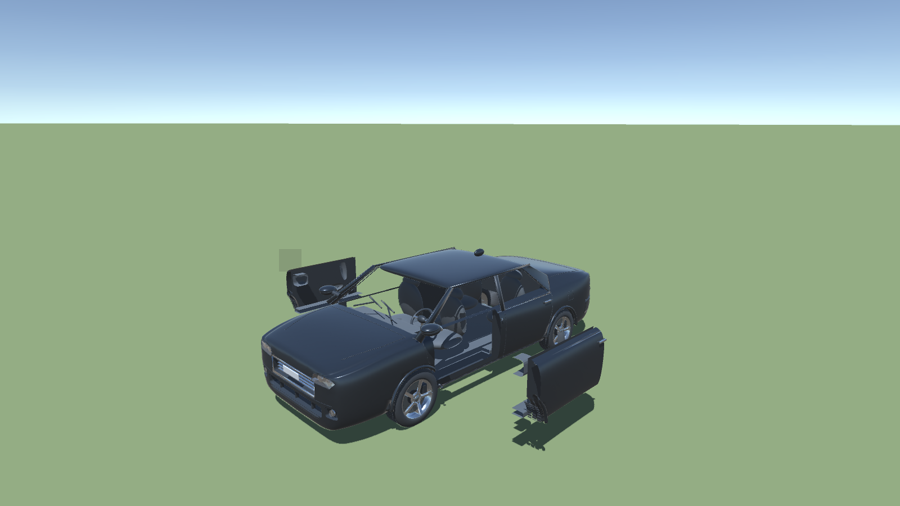
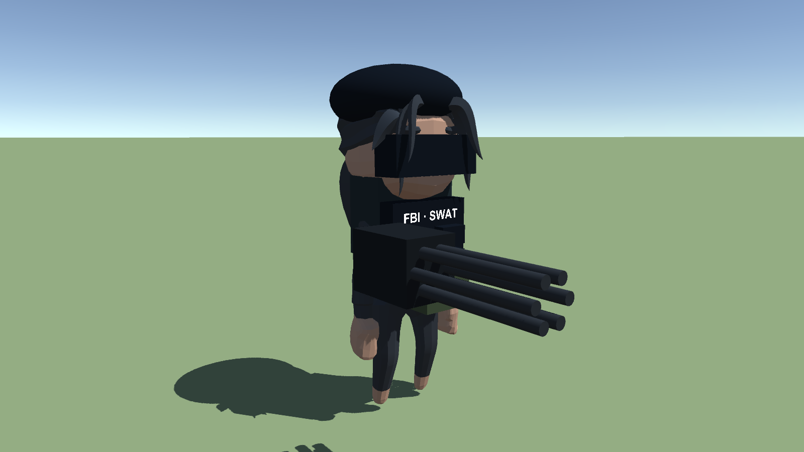
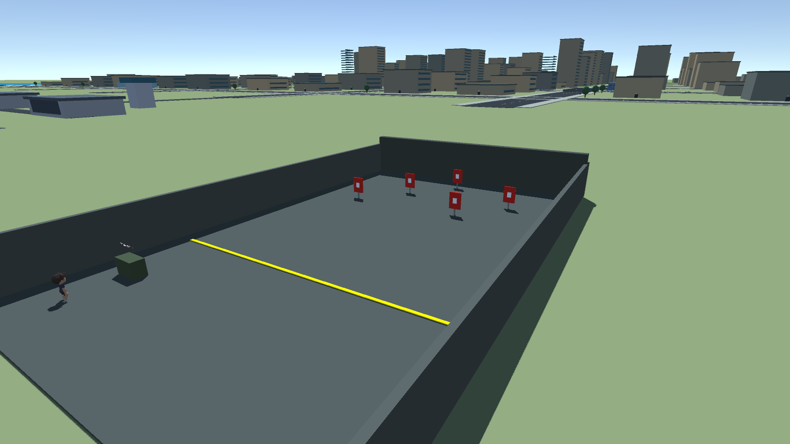
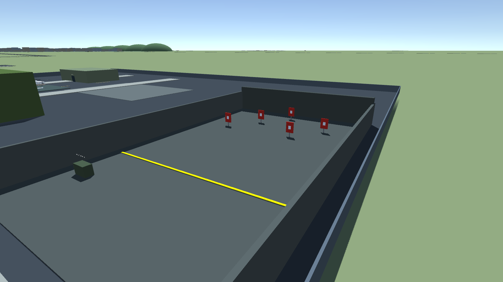
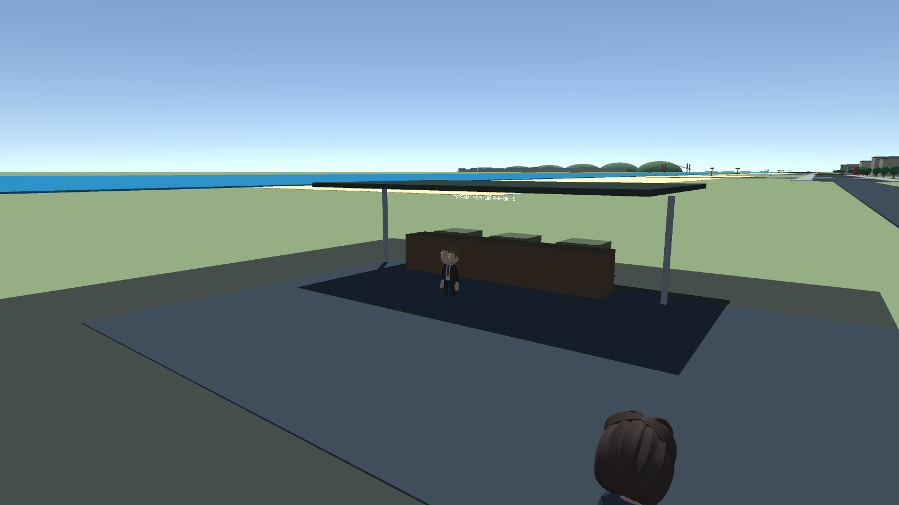

# Sunset State

Текущая версия: **0.3.3 preview**. Рабочий этап: основа для подготовки релизов и ограничение фоновой симуляции. Сохранены проверяемые сохранения, постоянные настройки, локальная диагностика и процесс упаковки. Это ещё не финальная коммерческая версия.

Одиночный 3D-прототип на Unity: свободный выбор профессии, транспорт, задания и криминальные события. Три основных города — Лос-Сантос, Сан-Фиерро и Лас-Вентурас — и отдельный тропический район Vice City. Геометрия мира авторская и процедурная.

## Запуск

- **Play.bat** — запустить готовую Windows-версию с сохранёнными настройками экрана; при первом запуске — полный экран.
- **PlayWindowed.bat** — запуск в окне. **F11** переключает режим экрана.
- **BuildAndRun.bat** — пересобрать и запустить. Нужен Unity **6000.0.77f1** с Windows Build Support.
- **Build.bat** — только сборка; результат в `Builds/Windows`.
- **Release.bat** — собрать, выполнить полный игровой прогон и создать проверенный ZIP в `Builds/Releases`. Для уже собранной игры: `Release.bat -UseExistingBuild`; проверка игры всё равно выполняется.

Файлы `SunsetState.exe`, `UnityPlayer.dll` и папка `SunsetState_Data` должны находиться вместе. Если Unity установлен в другом месте, задай переменную `UNITY_EDITOR` с полным путём к `Unity.exe`.

Кадры ниже получены из игровых сцен через внеэкранный рендер Unity; интерфейс поверх них не наложен.

## Надёжность, настройки и поддержка

Сохранение записывается через временный файл и атомарную замену; предыдущая корректная версия остаётся в `.bak`. Контрольная сумма SHA-256 обнаруживает повреждения. При испорченном основном файле игра читает резервную копию; повреждённый файл при следующей записи сохраняется в `.corrupt`. Старые профили совместимы и переходят на новую схему при следующем сохранении. Профиль от более новой версии игры не перезаписывается. Резервная копия содержит предыдущее сохранение, а не весь последний сеанс.

**Настройки** доступны в главном меню и через **Esc**: три уровня графики, ограничение 30/60/120 FPS или без лимита, вертикальная синхронизация, полный экран, размер окна, чувствительность мыши, инверсия вертикальной оси, отдельные уровни общего звука, музыки и двигателя. Настройки хранятся отдельно от прогресса и сохраняются между запусками. Явный запуск через PlayWindowed.bat переопределяет режим экрана.

При старте показываются этапы подготовки города, персонажа и карты. Это индикатор этапов, а не оценка оставшегося времени; геометрия мира пока создаётся одним большим этапом.

В настройках можно включить FPS и открыть **Диагностику**. Отчёт для поддержки создаётся только по кнопке, хранится локально и никуда автоматически не отправляется. В нём версия, параметры компьютера, оценка времени кадров и журнал ошибок. Папка обычного профиля Windows: `%USERPROFILE%\AppData\LocalLow\Sunset State\Sunset State`; настройки — `settings.json`, прогресс — `sunset-save.json`, журнал — `Diagnostics\session.log`. Журнал ограничен по размеру, сохраняется предыдущая копия. Тестовые прогоны используют отдельную временную папку.

## Фоновая симуляция большого мира

Обычные прохожие и исправные фоновые машины приостанавливаются вдали от игрока: у машин отключаются колёсная физика и движение тела, у прохожих — движение и анимация. Объекты остаются в мире, а геометрия и столкновения кузова сохраняются. Это ограничение симуляции, а не потоковая выгрузка карты.

Радиус пробуждения зависит от графики: **180 / 280 / 420 м**. Засыпание происходит ещё на 100 м дальше, чтобы на границе не возникало постоянного переключения. Проверки расстояния выполняются раз в четверть секунды. Настройка **«Ограничивать фоновую симуляцию»** позволяет отключить систему. Старые настройки автоматически переходят на новую схему с включённой оптимизацией.

Транспорт игрока, машины с управляющим ИИ, тестовыми командами, повреждением больше 1%, вертолёты, лодки, транспорт в воде и объекты рядом с текущей целью задания не приостанавливаются. Сопровождаемые NPC и участники разговора также остаются активными. Попадание, взрыв, наезд или посадка пробуждают затронутый объект. После приближения возвращаются прежние компоненты движения, колёсные коллайдеры и анимация. Счётчики приостановленных машин и NPC доступны в диагностике и отчёте поддержки.

Переключатели настроек показывают «ВКЛ / ВЫКЛ», а F11 использует сохранённый размер окна. Рост FPS на конкретном компьютере пока не измерен: этап проверен на корректность симуляции, а не как аппаратный бенчмарк.

## Подготовка сборки для распространения

`Release.bat` прекращает упаковку при ошибке исходников, сборки, тайм-ауте или неуспешном игровом прогоне. В ZIP входят игра, запускной батник, документация, лицензии и скриншоты; папки `DoNotShip`, символы отладки и журналы исключаются. `release-manifest.json` содержит список файлов, размеры и SHA-256, версию, время, Git-ревизию и признак локальных изменений. Рядом с ZIP создаётся `.sha256`. Проверить распакованный комплект: `powershell -File scripts/Test-Release.ps1 -ManifestPath <папка>\release-manifest.json` из исходного проекта.

Проверка исходников без Unity: `powershell -File scripts/Validate-Project.ps1`. GitHub Actions проверяет JSON зависимостей, уникальность Unity GUID, метаданные и ссылки README, а также отказ проверки релиза при изменённом файле или пути за пределами папки. Эта облачная проверка не заменяет сборку Unity; полноценный прогон выполняется локально через Release.bat.

Перед финальным релизом остаются: профилирование на целевом железе, потоковая загрузка районов, оптимизация активных NPC и массовых сцен, полноценная проверка интерфейсов на разных экранах, длительное ручное прохождение, художественная переработка мира и анимаций, разнообразие миссий и пользовательское тестирование. Сюжетные главы остаются текстовыми сценариями с повторяемыми механиками. Наличие ZIP и автоматических тестов не означает готовность уровня GTA.

## Камера, стрельба из транспорта и повреждения

Мышь свободно вращает камеру по горизонтали и позволяет смотреть вверх до 75° и вниз до 80°. **Колёсико, Num+ / Num−** приближают и отдаляют камеру; **Page Up / Page Down** тоже меняют масштаб, кроме танка, где они управляют стволом. Камера сокращает дистанцию перед стенами и землёй. Во время стрельбы автоматическое выравнивание за машиной отключено.

Обычные автомобили, лодки и вертолёты имеют **600 HP**, грузовики и автобусы — 900, двухколёсный транспорт — 360, танк — 2400. Запас прочности всего транспорта увеличен вдвое; урон оружия не уменьшен. Лёгкие касания меньше повреждают машину. При остатке менее 70% выбиваются окна; ниже 55 / 40 / 25 / 15% последовательно отрываются четыре панели дверей. Это визуальные отверстия в геометрии кузова и временные обломки без столкновений. Колёса и основной корпус сохраняются; полный ремонт возвращает исходные двери и окна. Для транспорта без дверей (мотоцикл, велосипед, лодка, танк) этот эффект не применяется.

Дым двигателя появляется ниже 40% прочности, разрежен и прозрачен. Частицы около камеры и между камерой и игроком плавно исчезают. Ограничен экранный размер частиц. Пожар начинается при критических 10%; сохраняются взрывы и повреждение от танковой пушки. Прочность видна на экране при вождении. Руление на скорости сохраняет достаточный угол колёс; помощь в повороте ограничена по скорости и работает только при контакте с землёй, с отдельным поведением ручника.

**Стрельба из транспорта:** клавиши **1–4** выбирают пистолет, Desert Eagle, Uzi или MP5; **ЛКМ** — огонь, **R** — перезарядка. Доступ определяется ролью и покупками оружия. Собственная машина не ловит свои пули, внешние стены останавливают их. Работают прицел и сопровождение видимой цели. Тяжёлое оружие, тайзер и дубинка используются пешком; у танка отдельная пушка.

**Миниган** доступен только полиции и ФБР через **I → Снаряжение**: лента 300 патронов, перезарядка 6 секунд, шесть вращающихся стволов. Армия, охрана тюрьмы, криминальные и гражданские роли его использовать не могут. Звук основан на существующей записи M4 с частыми выстрелами; отдельная запись настоящего минигана не включена.

## Тиры и навык стрельбы

**P → GPS → Общий тир / Армейский тир**, затем **E** у стойки. Общий тир открыт всем ролям и бесплатно выдаёт на занятие пистолет, MP5 или AK-47. Армейский тир предназначен для роли «Армия»: M4, РПК и снайперская винтовка.

Сессия длится до 60 секунд или 30 выстрелов. Стреляй по пяти красным мишеням с рубежа за жёлтой линией. Автоприцел в тренировке отключён; попадания учитываются реальными пулями. **E** завершает занятие, уход из зоны автоматически возвращает учебное оружие и исходные патроны. Учебные пули не повреждают людей и машины, занятие не снимает розыск; при розыске старт запрещён. Текущее поручение приостанавливается на время занятия.

За попадание — 3 опыта, от 15 попаданий — ещё 15. Навык сохраняется и действует во всех ролях: 10 уровней, каждый уменьшает разброс на 1,5%, максимум 15%. Сохранение во время занятия сохраняет исходный боезапас, а не выданные учебные патроны.

## Роли и истории

18 ролей: гражданский, полиция, ФБР, армия, медик, пожарный, таксист, дальнобойщик, механик, уличная банда, мэрия, лицензеры, охрана тюрьмы, заключённый, свободный бандит, **адвокат, мафия и губернатор**.

У каждой роли — 50 сюжетных глав и 10 обычных поручений: всего 900 глав и 180 поручений. Это текстовые истории с маршрутами, повторяемыми игровыми действиями и отдельными механиками, без озвученных диалогов и кат-сцен. Опыт, звание, гардероб и прогресс сохраняются отдельно для каждой роли.

- **Адвокат:** десять дел по пять этапов — встреча, документы, свидетель, экспертиза и заседание. В суде нужно выбрать подтверждённый материалами довод: оправдание либо смягчение наказания. Ошибочная защита заканчивается обвинительным решением и апелляцией в тексте результата.
- **Мафия:** захват отмеченного NPC, перевозка, удержание и переговоры в укрытии. Похищение вызывает розыск. Завершение поручения освобождает пленника.
- **Губернатор:** работа кабинета и три переключаемых закона. Медицинская субсидия отменяет плату за восстановление после поражения, поддержка занятости повышает выплаты на 10%, усиленный патруль меняет время снижения розыска. В свободном режиме примерно раз в три минуты возможна постановочная сцена похищения: мафия удерживает игрока, прибывшие сотрудники ФБР освобождают его.

## Полиция и ФБР

**F6** открывает выбор выезда. Ограбления 24/7, наркодилеры, нападения и защита банка доступны полиции и ФБР. Охрана мирного митинга требует защищать участников и находиться на площади; гибель участника проваливает задание.

Штурм, освобождение заложника из-под охраны мафии и обезвреживание опасного предмета закреплены за **ФБР**. После нейтрализации охраны освободи заложника клавишей E и доставь в участок. При изъятии товара и обезвреживании предмета удерживай E рядом три секунды. Обезвреживание представлено условным игровым действием без технических инструкций.

Тайзер действует до 45 м и сбивает живую пешую цель на 12 секунд; дубинка — в пределах 3,2 м на 8 секунд. Оглушение работает на противниках, прохожих и сотрудниках. Наручники применяются к подозреваемому рядом после оглушения. Доставлять можно одного задержанного за раз: в служебной машине с пассажирскими местами он становится пассажиром сзади, после выхода следует с конвоиром. В администрации тюрьмы начисляется награда за доставку.

В участке и бюро есть камеры заключения, допросная и предметы видеонаблюдения. Камеры видеонаблюдения — декорации, без экрана живого наблюдения. У ФБР в гардеробе есть комплект **SWAT**: тёмная форма, шлем, маска, разгрузка и обозначение FBI. Щит доступен полиции, ФБР и армии.

## Транспорт

Седаны, спортивные автомобили, внедорожники, мотоциклы, велосипеды, грузовики, автобусы, вертолёты, катера и танки. Отдельно выбираются личный и служебный автопарки. Скейт и сноуборд — личные аксессуары.

В личном гараже есть стилизации Ferrari F8, Tesla Model S, BMW M5/X5, Mercedes E63/G, Audi RS6, Porsche 911 и Lamborghini Huracan. Это вариации лицензированных универсальных кузовов с доработками и разными настройками, **не точные модели перечисленных автомобилей**. Суперкар и электроседан также добавлены в служебные гаражи. У электроседана синтезированный звук привода.

Физические колёса, подвеска, передачи, плавный руль, торможение, задний ход, ручник, противодействие крену и восстановление положения машины. У велосипеда вращаются педали и ноги; посадка на двухколёсном транспорте привязана к седлу.

Любой транспорт может сбить NPC. Выстрелы и столкновения уменьшают прочность машины: ниже половины появляется дым, при критическом состоянии — огонь и дальнейшая потеря прочности, при разрушении — взрыв. Близкие машины могут взорваться цепочкой. Танк поворачивает башню, стреляет и разрушает отмеченные типы объектов и зданий. Дороги и весь ландшафт полностью не разрушаются.

Здоровье и броня игрока от столкновения с препятствием не снимаются. Безопасный поиск места, контроль пересечений и восстановление уменьшают застревания; V восстанавливает машину на малой скорости.

Служебные надписи, TAXI на крыше, мигалки и сирены экстренных служб. Патрульные дроны полиции и ФБР. Формы и кепки позволяют различать организации.

## Вода, эвакуация и штрафы

У водоёмов есть глубина и дно. Наземная машина, упавшая в воду, затапливается, двигатель перестаёт тянуть; автоматическое восстановление V её оттуда не извлекает. E позволяет выйти и плыть: WASD — направление, Пробел — всплытие. Под водой есть 15 секунд воздуха, после этого убывает здоровье. Исправный катер держится на воде; разрушенный тонет.

**F7** — спасательная служба: эвакуация персонажа на берег бесплатна, подъём транспорта стоит $300. Это игровой переход на берег с размещением машины на свободном участке, без анимации крана.

В городе действует ограничение 60 км/ч: движение быстрее 70 км/ч дольше трёх секунд вызывает штраф $250 с паузой между повторными штрафами. На трёх отмеченных перекрёстках STOP нужен остановочный интервал не меньше секунды; проезд без остановки — $350. Уведомления приходят в телефон. Государственные роли и служебные машины освобождены; автомобили банд и мафии этой льготы не получают. Списывается доступная сумма наличных, долговой системы нет.

Государственные роли, банды и мафия получают бесплатный бронежилет через I → инвентарь. У бандитов и мафии оружие и пополнение патронов также бесплатны; гражданский покупает оружие и броню в магазине.

## Мир, магазины и банк

Карта охватывает три основных города, дополнительные районы и остров. На ней видны положение и направление игрока, цель и маршрут по дорожной сети. Названия районов размещаются без пересечений, список организаций прокручивается, на подробном плане здания показаны цветными контурами. Экранная стрелка показывает направление, действие и расстояние до цели, включая цель вне кадра. Есть приближение к базам и отделениям.

Территории армии, полиции, тюрьмы, мэрии и банд имеют ограждения, проходы, дворы и профильные постройки. Доступны повторяемые интерьеры жилых домов, магазинов, офисов и штаб-квартир. Это стилизованная геометрия, без фотореалистичных интерьеров каждого дома.

В 24/7 продаются еда, вода, алкоголь, аптечки, ремонт, броня, патроны и гражданское оружие. Личная аптечка Q бесплатно доступна всем. Лицензеры оформляют водительские, коммерческие и оружейные лицензии, объясняют знаки и ремонтируют повреждённые знаки и дорожные участки.

В государственном банке можно внести или снять $500. Бандит и мафия могут начать ограбление у банковской стойки: охрана, тревога, розыск, удержание E у хранилища и уход с добычей. Полиция и ФБР получают отдельные повторяющиеся задания на защиту банка.

Мужчины и женщины есть и среди NPC. Подойди к прохожему и нажми E: разговор, маршрут до магазина, поручение, первая помощь и прогулка. Это игровые текстовые взаимодействия. В инвентаре — мужские и женские персонажи, шесть вариантов облика роли, 27 аксессуаров и ограничения по профессиям. Бонусы аксессуаров влияют на бег, броню, лечение, защиту и точность.

## Уровни сложности

Перед новой игрой выбери **Легко, Нормально, Сложно или Кошмар** в главном меню. Во время игры сложность меняется через **Esc → Сложность** и сохраняется с прогрессом. Продолжение загружает уровень из сохранения; старые сохранения используют «Нормально».

| Уровень | Урон врагов | Точность выстрела при видимости | Интервал пополнения патруля |
| --- | --- | --- | --- |
| Легко | ×0,55 | 45% | 12 с |
| Нормально | ×1 | 70% | 8 с |
| Сложно | ×1,4 | 82% | 6 с |
| Кошмар | ×1,9 | 94% | 4 с |

На высоких уровнях враги также раньше открывают огонь и стреляют чаще. Прочность врагов, доступность сюжетных глав, правила тайзера и бесплатных аптечек сохраняются.

## Чёрный рынок и Гуррам

Гуррам стоит на чёрном рынке к юго-западу от Лос-Сантоса; второй рынок есть в Vice City. Найди его через **P → GPS → Чёрный рынок · Гуррам**, приезжай, выйди из машины и нажми **E** рядом с NPC. На карте рынок отмечен фиолетовым значком.

Гуррам снимает весь текущий розыск за **$500 за звезду**: от $500 до $2500. После оплаты преследующие машины, сотрудники полиции и ФБР отзываются, сирены и прогресс задержания сбрасываются. Задание и выбранная роль сохраняются. При нулевом розыске и при нехватке денег оплаты нет. Сделка доступна только при личном визите. Новое преступление снова вызывает обычный розыск — постоянной неприкосновенности услуга не даёт.

## Телефон и Vice City

Телефон **P**: сообщения от игровых контактов, текстовый звонок, приём следующей главы или рабочего поручения, GPS до отделений/банка/аэропорта/магазина, радио и громкость. Сообщения локальные, без подключения к реальным мессенджерам. Звонки текстовые. Переписка хранится в текущем сеансе.

**P → Радио / звук**: выбор из 21 трека с прокруткой, около 43 минут музыки. Добавлены семь полных композиций Alexander Ehlers из Free Music Pack (CC0): Doomed, Flags, Great Mission, Spacetime, Twists, Waking the Devil и Warped. Музыка скачана и включена в игру, интернет при запуске не требуется. После окончания начинается следующий трек, после последнего — первый. **T** — включение, **Y** — следующий трек, **− / =** — громкость. В машине радио работает автоматически; после ручного включения оно доступно и пешком. Пауза временно останавливает музыку.

Дополнительно включены 12 композиций: Funky House, Synthwave Type, Nova, Synthwave House Loop, Space Adventure, Lofi Hip Hop Loop, Chase (Adiutorium), Chase! (Ted Kerr), Funky Hip Hop Lofi Jam, Space City, Trance City и Urban Theme. Новые файлы доступны офлайн; авторы, ссылки и CC0-лицензии приведены в THIRD_PARTY_NOTICES.md, исходные SHA-256 — в Assets/Resources/Audio/Radio/RadioCredits.json.

Двигатель по умолчанию тише: громкость 0,12 против 0,24 у радио. Пока играет музыка, усиление собственного двигателя ограничивается четвертью громкости радио, соседних машин — 15%. При выключенном радио возвращается выбранный уровень двигателя. В телефоне доступны отдельные ползунки двигателя, музыки и общего звука. Сирены и предупреждающие сигналы сохраняют отдельную громкость.

Таксист видит пять предложений с оплатой и расстоянием подачи. После принятия GPS ведёт к пассажиру, затем к адресу назначения. Механика заказа использует остановки на маркерах; отдельная анимация посадки пассажира такси пока отсутствует.

Аэропорт Лос-Сантоса отмечается через телефон → GPS. Подойди к терминалу и нажми E. Виза в Vice City стоит $500 и действует 20 минут реального времени в запущенной игре. Перелёт сохраняет выбранную роль: на острове есть отделения всех ролей и местные маршруты работы. После истечения визы игрок возвращается в Лос-Сантос. Остаток визы сохраняется, время вне игры его не расходует. Для покупки нужен свободный персонаж без розыска.

Vice City — отдельный авторский тропический район с пастельными зданиями, пальмами, дорогами и аэропортом; оригинальная карта Rockstar не импортирована. Полёт представлен переходом между аэропортами.

## Управление

| Клавиши | Действие |
| --- | --- |
| WASD / мышь / колесо | Движение, езда, камера и расстояние |
| Shift / Пробел | Бег / прыжок; в машине Пробел — ручник |
| E | Взаимодействие, вход/выход из транспорта и зданий |
| Tab / J / K | Роль / задания / карьера |
| P / M | Телефон / карта |
| G / H / U | Служебный гараж / личный гараж / доска |
| I | Снаряжение; внутри — кнопка инвентаря и скинов |
| Q | Бесплатная личная аптечка |
| ЛКМ / ПКМ / R | Огонь / прицеливание или щит / перезарядка |
| 1–7 / 8 / 9 / 0 / F | Оружие / тайзер / дубинка / наручники / применение инструмента |
| F6 | Вызовы полиции и ФБР |
| N / C у силовых ролей | Мегафон / допрос задержанного |
| L пешком у мэрии/губернатора | Законы |
| L у лицензера | Продажа лицензий прохожему |
| B / O / L в машине | Гудок / маячки и сирена / фары |
| N в обычном автомобиле | Сигнализация |
| T / Y / − / = | Радио: включить, станция, громкость |
| F7 | Спасение из воды / эвакуация транспорта |
| V / F11 / Esc | Восстановить машину / полный экран / пауза |
| Z / X / PageUp / PageDown | Башня и ствол танка |
| ЛКМ / ПКМ в танке | Выстрел / наведение |
| Пробел / Ctrl в вертолёте | Подъём / снижение |

Сюжетный маркер обычно требует остановиться на три секунды. Некоторые этапы дополнительно требуют инструмент, обезвреживание противников, решение в суде или спасение NPC. Островные смены используют упрощённые маршруты профессий.

## Сохранение и проверка

Автосохранение каждые 30 секунд, при смене роли и после заданий. Ручное сохранение — в паузе. Профиль: `%USERPROFILE%/AppData/LocalLow/Sunset State/Sunset State/sunset-save.json`. Старые профили расширяются при загрузке. Динамические заложники, задержания, разрушения и активные вызовы между запусками не восстанавливаются.

`Build.bat --check` проверяет путь к редактору. `Play.bat --check` проверяет комплект сборки. `Play.bat --smoke` запускает автоматические проверки на отдельном временном профиле: роли и определения всех заданий, сохранения, физика, столкновения, посадка, педали, оружие, оглушение, разрушение, магазины, формы, суд, операции ФБР, похищение губернатора, виза, банк, телефон/GPS, конвоирование, затопление, кислород, плавание, эвакуацию, штрафы и бесплатное оснащение. Подробности последнего прогона: [VALIDATION.md](VALIDATION.md).

## Исходники

Открывай папку проекта через Unity Hub. В репозиторий включаются `Assets`, `Packages`, `ProjectSettings`, сценарии запуска, документация и проверенные скриншоты. Кэш Unity, сборки, исходные архивы загрузок, временные файлы и журналы исключены через `.gitignore`. Готовый Windows-каталог можно распространять отдельно целиком.

Лицензии моделей, музыки и записанных звуков: [THIRD_PARTY_NOTICES.md](THIRD_PARTY_NOTICES.md). Проект не связан с Rockstar Games или Arizona RP; оригинальные игровые карты, персонажи и аудио GTA в сборку не включены.

Въезд военной базы соединён отдельным подъездом с улицей. На КПП есть табло въезда и выезда, парковка отделена от проезда. При выходе с базы навигация ведёт через КПП. Дальность камеры увеличена до 3,5 км, плотность светлого тумана снижена. Надписи формы ограничены размерами нашивок при повороте персонажа, таблички зданий сохраняют положение на поверхности.
